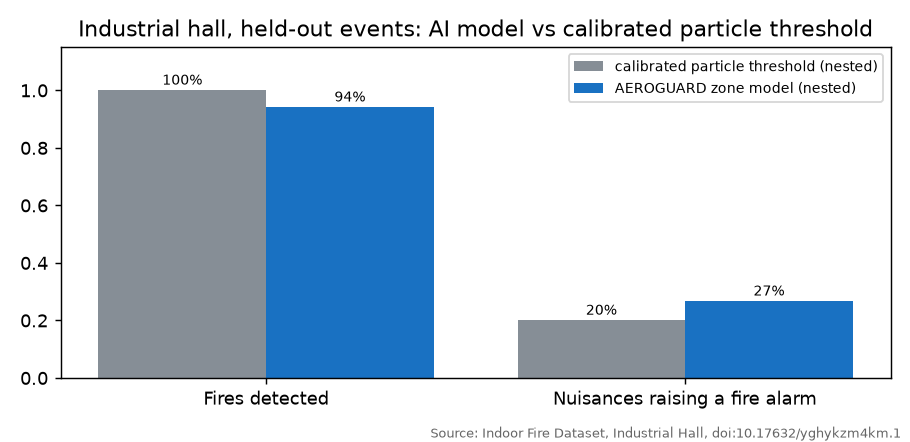
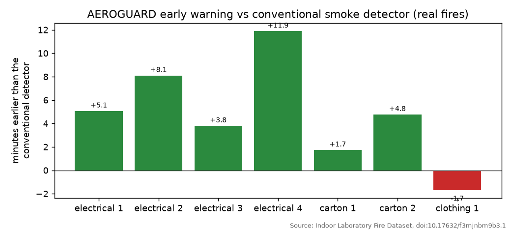

# AI evaluation report

All numbers below are **measured** on real public datasets (Industrial Hall, Indoor Laboratory, MetroPT-3, SKAB).
Nothing is synthetic. Rebuild with `.venv/Scripts/python -m ai.train`. Model version 1.0.0.
Provenance and data-quality findings: [docs/DATA_PROVENANCE_AUDIT.md](../../docs/DATA_PROVENANCE_AUDIT.md).

## Status of each claim

| Claim | Evidence | Status |
|---|---|---|
| 1. **Fire detection** in an industrial hall, telling fires from nuisances | Industrial Hall, leave-one-event-out + nested rule selection | **Held-out estimate** (small sample, wide intervals) |
| 2. **Earlier than a conventional detector** | Indoor Laboratory fires, rule fixed in advance | **Held-out by construction** (no training), 7 fires; laboratory, not a factory |
| 3. **Equipment anomaly / failure detection** | MetroPT-3 compressor (4 failures), SKAB motor bench | **Exploratory** for the compressor (model choice made after seeing the 4 failures); held-out tuning split for SKAB |
| 4. **Prevention of industrial fires** | None | **Not demonstrated.** No dataset links detected anomalies to fires that were then avoided |

## 1. Zone model: real fire or industrial nuisance? (primary MVP model)

Gradient-boosted trees on features relative to each sensor node's recent background (CO, CO₂, H₂, VOC,
particles by size, temperature, humidity). **Leave-one-event-out**: each of the 32 recordings is judged by
a model that never saw it. Welding and abrasive cutting have a single recording each, so they are tested as
**completely unseen** sources.

Decision rule: **coincidence detection** (as in "double-knock" fire systems): the zone alarms when at least
N sensor nodes are confident (P(fire) ≥ p) for 30 s. The pair (p, N) is chosen by a criterion fixed in advance
(detect every fire, then fewest nuisance alarms, then fewest background alarms, then fastest).

**Honest estimate (nested):** for each event, (p, N) is chosen using only the *other* events, then applied to it.

| Result | AEROGUARD, nested (headline) | AEROGUARD, rule p≥0.95, N≥2 chosen on all events (optimistic) | Calibrated particle threshold, nested |
|---|---|---|---|
| Real fires detected | 16/17 = 94% (95% CI 73%–99%) | 17/17 | 17/17 = 100% (95% CI 82%–100%) |
| Nuisances raising a fire alarm | 4/15 = 27% (95% CI 11%–52%) | 4/15 | 3/15 = 20% (95% CI 7%–45%) |
| Median time from event start to alarm | 397.0 s | 371.0 s | 617.0 s |
| Background alarm episodes | see below | 13 | 0 |

**Key finding:** a particle threshold calibrated with the same nested protocol performs **as well as or better than** the
AI model on fire detection, nuisance rejection and background alarms on this dataset. The AI model alarms earlier
(median), but its nuisance rejection advantage is not demonstrated against a well-calibrated simple rule.

Rules selected across the nested folds: {'p>=0.95, nodes>=2': 31, 'p>=0.95, nodes>=3': 1}. The event missed in the nested estimate is the
one for which leaving it out makes the stricter rule look best.

Background (rule p≥0.95, N≥2), 64.2 h of continuous recording including nights:
1 alarm(s) in quiet periods, 11 within 70 min after an event (smoke lingering,
unventilated hall), 1 during sensor warm-up (first 30 min of the recording). The 70-minute
"post-event" window was defined **after** looking at where background alarms occur, so this split is descriptive.

Particle baseline: a node alarms when its particle count exceeds its background by more than a threshold
for 30 s; any node suffices. The threshold is chosen per held-out event from [250, 500, 1000, 1500, 2000, 3000] with the same criterion
as the AI rule (selected: {1500: 32}). It is a simplified stand-in for an optical smoke detector, not a
certified device. An earlier version of this report set the threshold from a stray single-row label and reported
15/15 nuisance alarms for this baseline; that was a bug and has been corrected.

Residual dependence: the out-of-fold probabilities of other events come from models that did see the held-out
event, so the nested rule choice is not perfectly independent. With 32 events this is the best available split.

**Remaining nuisance alarms**: ethanol, the two fog-machine "smoke" runs and welding. Welding is a single
recording, so here the model had **never seen welding** during training. On a real site, welding recordings
from that site and the platform's hot-work permits (declared welding zones and times) would be used.

All rules tested (trade-off between catching fires and ignoring nuisances):

| p_fire | min_nodes | fires_detected | fire_events | nuisance_false_alarms | nuisance_events | bg_alarms_quiet | bg_alarms_post_event | bg_alarms_warmup | median_time_to_alarm_s |
|---|---|---|---|---|---|---|---|---|---|
| 0.5 | 1 | 17 | 17 | 13 | 15 | 23 | 33 | 1 | 18.0 |
| 0.7 | 1 | 17 | 17 | 12 | 15 | 12 | 33 | 1 | 37.0 |
| 0.8 | 1 | 17 | 17 | 11 | 15 | 8 | 25 | 1 | 60.0 |
| 0.9 | 1 | 17 | 17 | 10 | 15 | 8 | 22 | 1 | 81.0 |
| 0.95 | 1 | 17 | 17 | 5 | 15 | 6 | 18 | 1 | 228.0 |
| 0.5 | 2 | 17 | 17 | 11 | 15 | 7 | 31 | 1 | 23.0 |
| 0.7 | 2 | 17 | 17 | 10 | 15 | 6 | 28 | 1 | 88.0 |
| 0.8 | 2 | 17 | 17 | 8 | 15 | 6 | 22 | 1 | 108.0 |
| 0.9 | 2 | 17 | 17 | 5 | 15 | 4 | 18 | 1 | 203.0 |
| 0.95 | 2 | 17 | 17 | 4 | 15 | 1 | 11 | 1 | 371.0 |
| 0.5 | 3 | 17 | 17 | 11 | 15 | 7 | 27 | 1 | 53.0 |
| 0.7 | 3 | 17 | 17 | 7 | 15 | 5 | 21 | 1 | 111.0 |
| 0.8 | 3 | 17 | 17 | 4 | 15 | 3 | 21 | 1 | 168.0 |
| 0.9 | 3 | 17 | 17 | 4 | 15 | 2 | 14 | 1 | 413.0 |
| 0.95 | 3 | 16 | 17 | 3 | 15 | 2 | 7 | 1 | 527.5 |

Per event (nested estimate; rule chosen without that event):

| event | truth | fire_alarm | time_to_alarm_s | rule_p_fire | rule_min_nodes |
|---|---|---|---|---|---|
| Abrasive_Cutting#1 | nuisance | False |  | 0.95 | 2 |
| CO#1 | nuisance | False |  | 0.95 | 2 |
| CO#2 | nuisance | False |  | 0.95 | 2 |
| Cable#2 | fire | False |  | 0.95 | 3 |
| Cable#3 | fire | True | 118.0 | 0.95 | 2 |
| Cable#4 | fire | True | 240.0 | 0.95 | 2 |
| Candles#1 | fire | True | 257.0 | 0.95 | 2 |
| Candles#2 | fire | True | 588.0 | 0.95 | 2 |
| Candles#3 | fire | True | 1013.0 | 0.95 | 2 |
| Candles#4 | fire | True | 443.0 | 0.95 | 2 |
| Deodorant#1 | nuisance | False |  | 0.95 | 2 |
| Deodorant#2 | nuisance | False |  | 0.95 | 2 |
| Deodorant#3 | nuisance | False |  | 0.95 | 2 |
| Ethanol#1 | nuisance | True | 131.0 | 0.95 | 2 |
| Ethanol#2 | nuisance | False |  | 0.95 | 2 |
| Exhaust#1 | nuisance | False |  | 0.95 | 2 |
| Exhaust#2 | nuisance | False |  | 0.95 | 2 |
| Exhaust#3 | nuisance | False |  | 0.95 | 2 |
| Green_Waste#1 | nuisance | False |  | 0.95 | 2 |
| Lunts#1 | fire | True | 168.0 | 0.95 | 2 |
| Lunts#2 | fire | True | 37.0 | 0.95 | 2 |
| Lunts#3 | fire | True | 118.0 | 0.95 | 2 |
| Smoke#1 | nuisance | True | 320.0 | 0.95 | 2 |
| Smoke#2 | nuisance | True | 103.0 | 0.95 | 2 |
| Welding#1 | nuisance | True | 165.0 | 0.95 | 2 |
| Wood#1 | fire | True | 337.0 | 0.95 | 2 |
| Wood#2 | fire | True | 423.0 | 0.95 | 2 |
| Wood#3 | fire | True | 371.0 | 0.95 | 2 |
| Wood#4 | fire | True | 815.0 | 0.95 | 2 |
| Wood#5 | fire | True | 435.0 | 0.95 | 2 |
| Wood#6 | fire | True | 747.0 | 0.95 | 2 |
| Wood#7 | fire | True | 437.0 | 0.95 | 2 |

## 2. Early warning vs the conventional smoke detector

Unsupervised, no training: each recording's first 120 s define normal; a warning
is raised when ≥ 2 channels exceed a robust z-score of 8.0 for 5 consecutive readings
(5 s for the 1 Hz files, 10 s for `electrical_1` and `electrical_2`, which are sampled every 2 s).
The threshold, channel count and noise floors were set before the per-experiment results were computed;
the sensitivity table below shows other settings.

Headline: warned before the conventional detector in 6/7 = 86% (95% CI 49%–97%);
electrical fires: [5.1, 8.1, 3.8, 11.9] minutes earlier. "Stage 0" (authors' no-fire label) is short in most
recordings, so the false-warning check covers little time; it is not a false-alarm rate.

| experiment | source | detector_min | aeroguard_min | lead_min | warned_before_detector | false_warning_in_stage0 | first_channel |
|---|---|---|---|---|---|---|---|
| electrical_1 | electrical | 37.0 | 32.0 | 5.1 | True | False | tvoc_ppb |
| electrical_2 | electrical | 32.8 | 24.7 | 8.1 | True | False | tvoc_ppb |
| electrical_3 | electrical | 44.1 | 40.3 | 3.8 | True | False | tvoc_ppb |
| electrical_4 | electrical | 48.6 | 36.7 | 11.9 | True | False | tvoc_ppb |
| carton_1 | carton | 3.8 | 2.1 | 1.7 | True | False | tvoc_ppb |
| carton_2 | carton | 6.9 | 2.1 | 4.8 | True | False | mq139_raw |
| clothing_1 | clothing | 6.8 | 8.4 | -1.7 | False | False | eco2_ppm |
| clothing_2 | clothing | 0.3 | 2.6 | -2.3 | False | False | eco2_ppm |

`clothing_2` is excluded from the scores: its conventional detector switched on at 0.3 min, inside the
calibration window.

Sensitivity to the threshold (shows the result does not depend on one lucky setting):

| z_threshold | min_channels | warned_before_detector | median_lead_time_min | electrical_median_lead_min | false_warnings_stage0 |
|---|---|---|---|---|---|
| 4 | 1 | 7/7 | 27.8 | 32.3 | 2 |
| 6 | 1 | 7/7 | 19.5 | 26.6 | 2 |
| 8 | 1 | 7/7 | 6.0 | 24.0 | 1 |
| 12 | 1 | 6/7 | 9.7 | 17.5 | 0 |
| 16 | 1 | 6/7 | 6.4 | 10.0 | 0 |
| 4 | 2 | 7/7 | 6.0 | 15.3 | 2 |
| 6 | 2 | 7/7 | 4.8 | 7.1 | 0 |
| 8 | 2 | 6/7 | 4.8 | 6.6 | 0 |
| 12 | 2 | 6/7 | 4.3 | 4.9 | 0 |
| 16 | 2 | 6/7 | 3.3 | 4.3 | 0 |

## 3. Compressor early warning on 4 real failures (MetroPT-3)

Trained only on February–March 2020 (no failure reported). 30-minute windows; features: duty cycle,
starts, longest run, oil temperature, **physics residual** (measured minus energy-balance prediction), current,
pressures. Alarm = score above the 99.5th percentile of training scores for 1 h. An alarm up to 48 h before a
reported failure counts as an early warning.

| model | failures | detected | detected_before_start | median_lead_time_h | false_alarm_episodes | normal_weeks_evaluated | false_alarms_per_week |
|---|---|---|---|---|---|---|---|
| Autoencoder | 4 | 4 | 2 | 18.0 | 15 | 15.4 | 0.97 |
| Isolation Forest | 4 | 3 | 0 | -17.5 | 3 | 15.4 | 0.19 |

| model | failure | start | detected | first_alarm | lead_time_h |
|---|---|---|---|---|---|
| Autoencoder | 1 | 2020-04-18 00:00:00 | True | 2020-04-18 00:30:00 | -0.5 |
| Autoencoder | 2 | 2020-05-29 23:30:00 | True | 2020-05-29 23:30:00 | 0.0 |
| Autoencoder | 3 | 2020-06-05 10:00:00 | True | 2020-06-03 10:30:00 | 47.5 |
| Autoencoder | 4 | 2020-07-15 14:30:00 | True | 2020-07-14 02:30:00 | 36.0 |
| Isolation Forest | 1 | 2020-04-18 00:00:00 | True | 2020-04-18 17:30:00 | -17.5 |
| Isolation Forest | 2 | 2020-05-29 23:30:00 | False | NaT |  |
| Isolation Forest | 3 | 2020-06-05 10:00:00 | True | 2020-06-06 04:00:00 | -18.0 |
| Isolation Forest | 4 | 2020-07-15 14:30:00 | True | 2020-07-15 15:00:00 | -0.5 |

Reading (**exploratory**): the autoencoder detects 4/4 failures and alarms before the reported start for
2 of them, at about 0.97 false alarm episodes per week of normal operation. The 47.5 h
warning is at the edge of the 48 h window and may be a coincidental alarm. Isolation Forest raises fewer false alarms
but alarms only after failures start. Both models are shown because the choice between them was made after seeing
the 4 failures. This is a railway compressor, used here as evidence for the method, not as factory data.

## 4. Motor / pump anomalies (SKAB, laboratory bench)

First 400 samples of each experiment = normal reference (SKAB convention). Experiments whose first 400 samples
already contain labelled anomalies are excluded (`other/2`). Thresholds tuned on the `valve1` experiments,
results on the others. F1 is point-wise; about 35 % of test points are anomalous, which favours permissive
methods, so the false-alarm rate is shown next to it.

| method | tuned | tp | fp | fn | tn | experiments | f1 | false_alarm_rate | missed_alarm_rate | anomalies_detected | median_detection_delay_s |
|---|---|---|---|---|---|---|---|---|---|---|---|
| Fixed k-sigma limits | k=2.5 | 5672 | 2466 | 702 | 2821 | 17 | 0.782 | 0.466 | 0.11 | 16/17 | 3.0 |
| PCA residual (Q statistic) | margin=0.8 | 3800 | 1184 | 2574 | 4103 | 17 | 0.669 | 0.224 | 0.404 | 17/17 | 38.0 |
| MLP autoencoder | margin=0.8 | 5408 | 2164 | 966 | 3123 | 17 | 0.776 | 0.409 | 0.152 | 17/17 | 4.0 |

Reading: on this bench the autoencoder matches the classic k-sigma limits on F1 while detecting every anomaly and
raising fewer false alarms. The gain is modest; it is reported as such.

## Limitations

- The fire datasets are laboratory and test-hall experiments, not a Tunisian factory. Real deployment needs a
  calibration period on site.
- Welding and abrasive cutting have one recording each; more nuisance data would make the zone model more robust.
- MetroPT-3 has only 4 reported failures: the lead times are evidence, not statistics.
- The Protection Civile incident data, once received, will be used to validate the risk engine's priorities.
