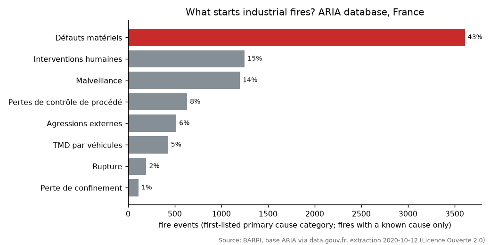
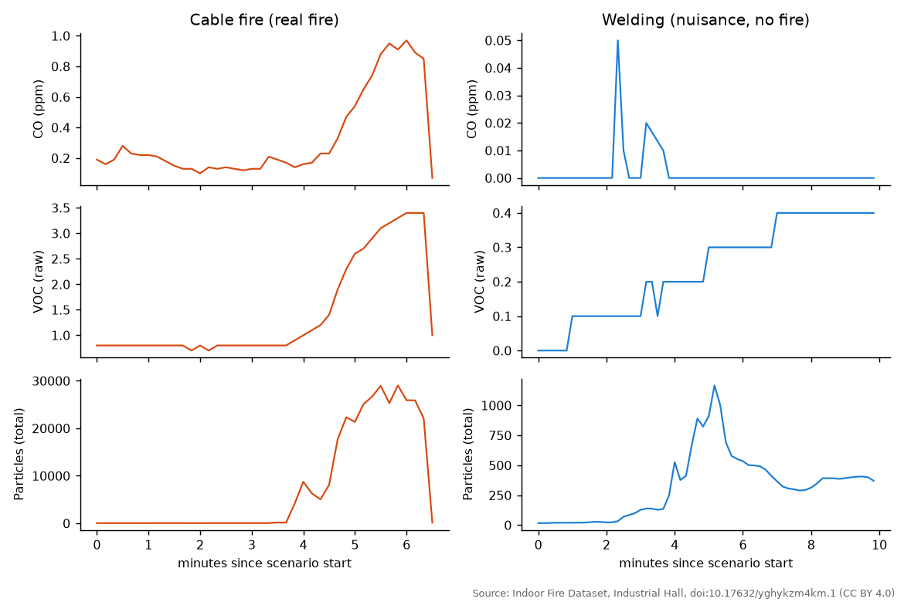
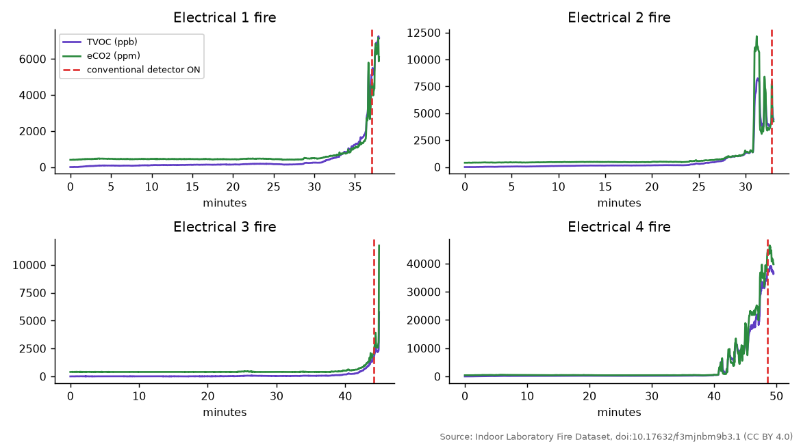
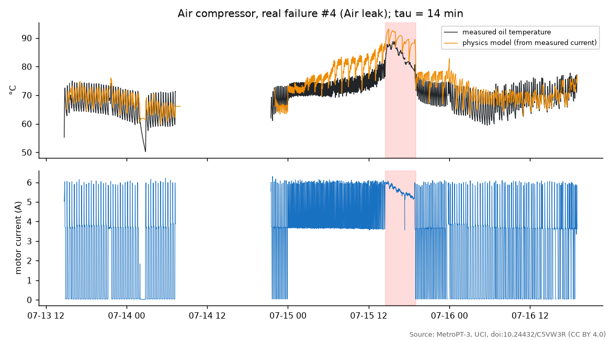
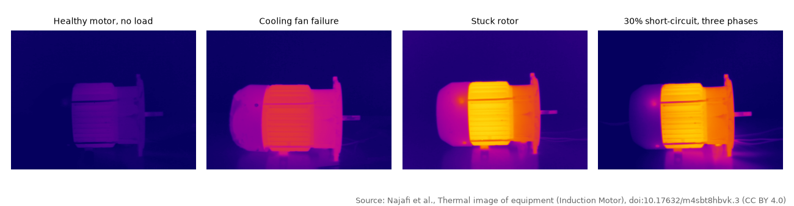

# Datasets

AEROGUARD TRUST uses **only real, public data**. Nothing is synthesised. The raw files are not stored in this repository: `ingest/` downloads each one from its official source, checks it against the publisher's SHA-256 when one is published, and records what was fetched in `data/raw/MANIFEST.json`.

```bash
.venv/Scripts/python -m ingest download      # all datasets (about 600 MB unpacked)
.venv/Scripts/python -m ingest list          # sources and licenses
.venv/Scripts/python scripts/data_figures.py # rebuild the figures below
```

A **Protection Civile (Tunisia) incident database** has been requested. It will be added as soon as it is received.

## Overview

| Dataset | What it contains | Used for | License |
|---|---|---|---|
| [Indoor Fire Dataset, Industrial Hall](https://data.mendeley.com/datasets/yghykzm4km/1) · doi:10.17632/yghykzm4km.1 | 248,502 rows from 9 sensor nodes in a 10×22×8 m industrial hall: 4 incipient fires (wood, **cable**, candles, lunts) and 8 nuisances (**welding**, **abrasive cutting**, exhaust, CO, ethanol, deodorant, fog, green waste). CO, CO₂, H₂, VOC, particles, temperature, humidity | Zone sensor model: real fire vs industrial nuisance | CC BY 4.0 |
| [Indoor Laboratory Fire Dataset](https://data.mendeley.com/datasets/f3mjnbm9b3/1) · doi:10.17632/f3mjnbm9b3.1 | 8 controlled fires (**4 electrical**, 2 carton, 2 clothing), a reading every 2 s, with the state of a **conventional smoke detector** | Detection lead time vs the conventional detector | CC BY 4.0 |
| [Indoor Fire Dataset, Small-Scale Test Chamber](https://data.mendeley.com/datasets/m85f9h6g9j/1) · doi:10.17632/m85f9h6g9j.1 | 2,900 rows, fires escalating through intensity stages | Escalation stages for the risk engine | CC BY 4.0 |
| [SKAB, Skoltech Anomaly Benchmark](https://github.com/waico/SKAB) · doi:10.34740/KAGGLE/DSV/1693952 | 35 experiments on a pump + motor test bench: vibration (2 accelerometers), motor current, voltage, temperature, pressure, flow; labelled anomalies | Motor anomaly model | GPL-3.0 |
| [MetroPT-3](https://archive.ics.uci.edu/dataset/791/metropt+3+dataset) · doi:10.24432/C5VW3R | Air compressor of a Porto metro train, Feb–Aug 2020: 7 analog + 8 digital signals, **4 real failures from maintenance reports** | Compressor model, early failure detection, physics model | CC BY 4.0 |
| [Thermal image of equipment (Induction Motor)](https://data.mendeley.com/datasets/m4sbt8hbvk/3) · doi:10.17632/m4sbt8hbvk.3 | 369 real infrared images of an induction motor: healthy, cooling-fan failure, stuck rotor, stator short-circuits (10–50 %, 1–3 phases) + 40 expert ground truths | Drone thermal inspection (hotspot detection) | CC BY 4.0 |
| [ARIA, BARPI (France)](https://www.data.gouv.fr/datasets/analyse-recherche-et-information-sur-les-accidents) | 53,958 industrial accidents and incidents, of which **25,687 involve fire**: sector, equipment, primary and root causes, consequences | Real accident statistics until the Protection Civile data arrives | Licence Ouverte 2.0 (data.gouv.fr extraction of BARPI data) |

## What the data already shows

### 1. 43 % of industrial fires start with equipment failure


Of the 8,333 ARIA fires with a known primary cause, 3,611 (43 %) list **equipment failure ("Défauts matériels")** first, far ahead of human intervention (15 %). Monitoring equipment condition targets the largest cause.

### 2. A cable fire and welding look different to multi-gas sensors


The cable fire produces a sustained rise in CO, VOC and particles (about 29,000 particle counts at peak). Welding produces short, much smaller spikes (about 1,200). This is the signal the zone model learns, so that welding does not trigger a fire alert.

### 3. Electrical fires show gas changes before the conventional detector


In the four electrical fires, TVOC and eCO₂ start rising before the conventional detector turns on (red line). Part 2 measures this lead time.

### 4. A real compressor failure has a visible physical signature


Before and during the reported air leak (#4), the compressor stops cycling and runs continuously.

### 5. Real infrared images for the drone's thermal check


## Physics model (fitted on real measurements)

The spec requires a physical simulation. We use physics **without generating data**: a lumped first-order energy balance (Joule heating + Newton cooling, `physics/thermal.py`) is identified on real MetroPT-3 measurements and predicts oil temperature from the **measured** motor current.

| Result (MetroPT-3, model fitted on February–March 2020) | Value |
|---|---|
| Identified thermal time constant τ | 13.6 min |
| Steady-state oil temperature rise at 7 A | 37.6 K |
| R² of 60-minute free-run prediction, February–March (fit period) | 0.57 |
| R² of 60-minute free-run prediction, April–August (unseen) | 0.38 |
| Mean \|measured − physics\| in normal operation (April–August) | 3.0 K |
| Mean \|measured − physics\| during reported failures | 7.5 K |
| Mean \|measured − physics\| in the 24 h before a failure | 2.6 K |
| Compressor duty cycle: normal / during failure | 38 % / 94 % |

Reading: the physics explains part of the temperature dynamics (ambient temperature is not measured, which limits R²). The physics residual is 2.5× larger during failures, but it **does not by itself warn in advance**; early warning is the job of the AI model (Part 2), which uses this residual as one input.

## Caveats (stated in the model report)

- **SKAB** is a laboratory test bench, not a factory. Its motor temperature barely follows electrical power (correlation 0.08), so it is not used for the physics model.
- **MetroPT-3**: the official PDF numbers two failure rows "#1"; we keep the published times. Times are local to Porto. The logger has gaps, which are left as gaps.
- **Test chamber**: the description says intensity stages go "up to 6", but the published file reaches 4. It also contains scenarios not listed in the description (heptane flame, polyurethane, H₂, CO, ventilation).
- **Indoor lab**: column names differ slightly between files; the loader harmonises them. The `stage` column is the authors' annotation (0 = no fire).
- **ARIA** is a 2020 snapshot of a French database, not Tunisian data. Causes are flattened category lists; we count the first-listed category per event to avoid double counting.
- **No public dataset of electrical-panel thermal images** with loose-connection labels was found. The induction-motor images are the closest real substitute.

## Citations

- Indoor Fire Dataset with Distributed Multi-Sensor Nodes (Industrial Hall), Mendeley Data, V1, 2024. doi:10.17632/yghykzm4km.1
- Nazir, A. et al. Indoor Laboratory Fire Dataset, Mendeley Data, V1, 2021. doi:10.17632/f3mjnbm9b3.1. Paper: *Early Fire Detection: A New Indoor Laboratory Dataset and Data Distribution Analysis*, Fire 5(1), 11, 2022.
- Indoor Fire Dataset of Multi Sensor Data (Small Scale Test Chamber), Mendeley Data, V1, 2024. doi:10.17632/m85f9h6g9j.1
- Katser, I. D., Kozitsin, V. O. Skoltech Anomaly Benchmark (SKAB), 2020. doi:10.34740/KAGGLE/DSV/1693952
- Veloso, B., Gama, J., Ribeiro, R., Pereira, P. MetroPT-3 Dataset, UCI Machine Learning Repository, 2023. doi:10.24432/C5VW3R. Papers: Davari et al., IEEE DSAA 2021 (doi:10.1109/DSAA53316.2021.9564181); Veloso et al., Scientific Data 9:764, 2022 (doi:10.1038/s41597-022-01877-3).
- Najafi, M. et al. Thermal image of equipment (Induction Motor), Mendeley Data, V3, 2023. doi:10.17632/m4sbt8hbvk.3
- BARPI, base ARIA (Analyse, Recherche et Information sur les Accidents), extraction published on data.gouv.fr, 2020-10-12.
