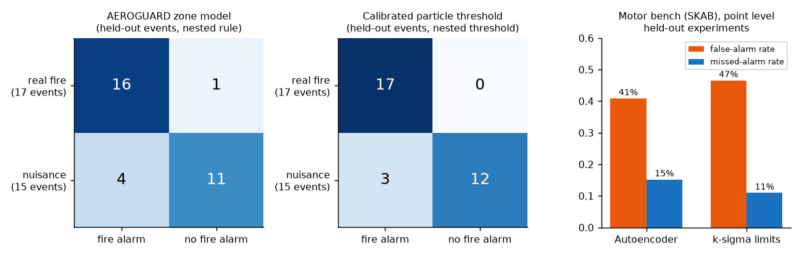
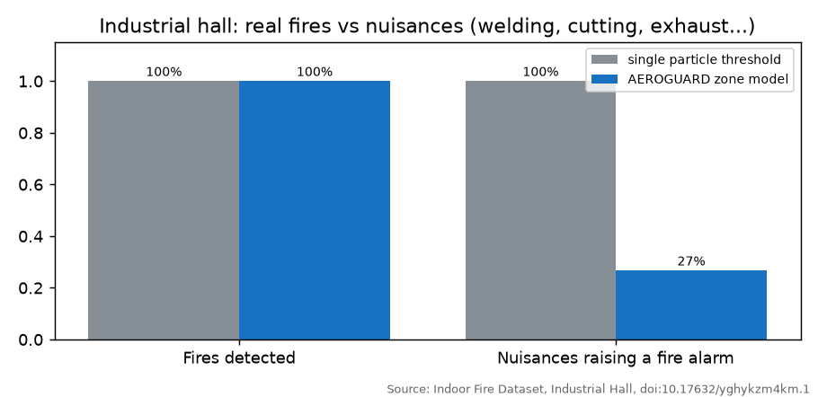
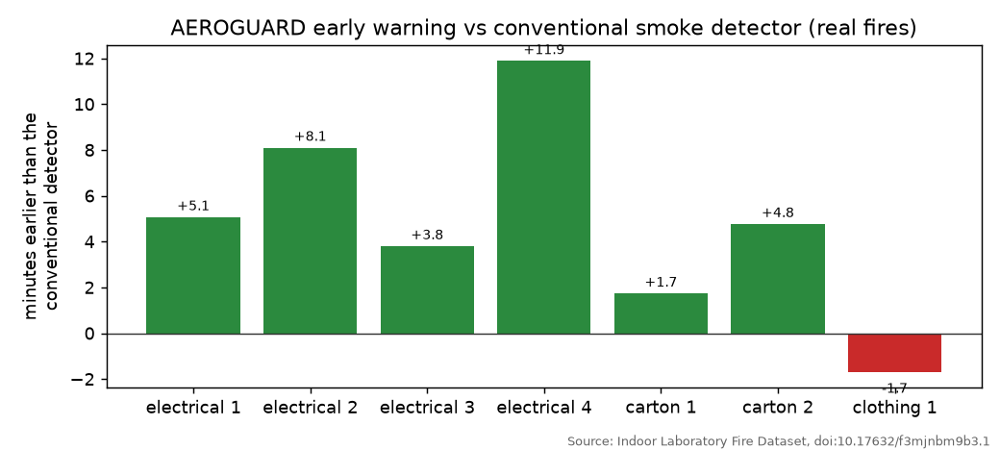
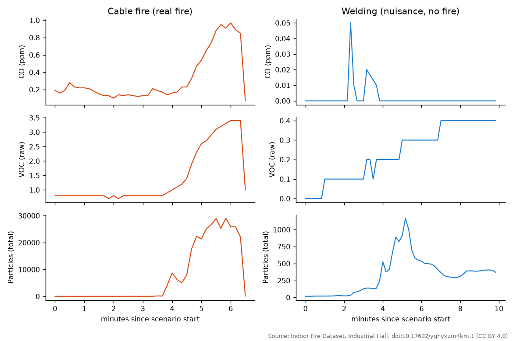
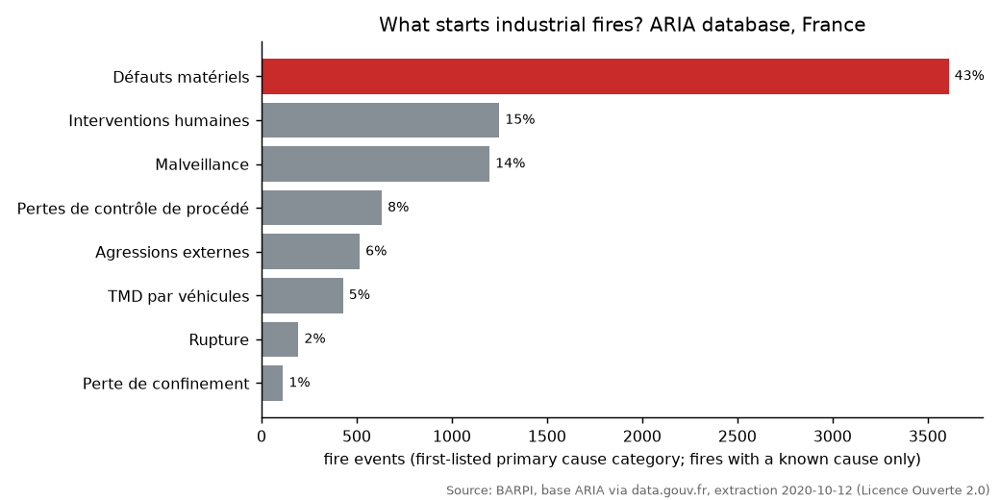
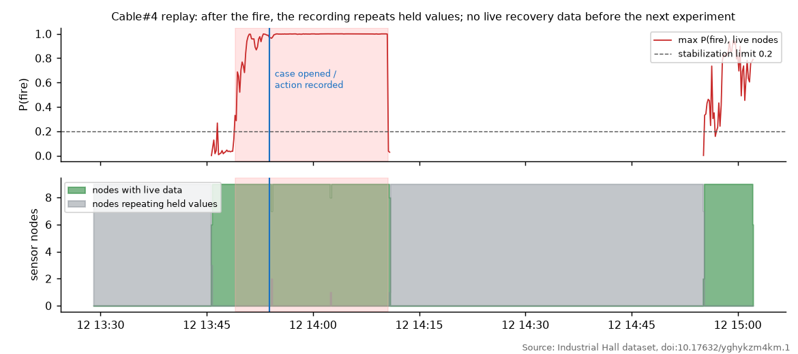

# AEROGUARD TRUST — AI Model Report

**Team ORBITA · INSAT · AeroEntrepreneur 2026 (Tunisian Aeroday × Protection Civile × INJAZ Tunisia)**
Version 2026-11-21. Generated by `scripts/build_model_report.py` from the saved held-out predictions and registered models; no number in this report is typed by hand.

The hackathon specification asks the model report to cover the **architecture**, **why this model was chosen**, and the **dataset used** (§04, "Rapport du modèle"). Sections 3, 5 and 6 answer these directly.

---

## 1. Executive summary

AEROGUARD TRUST monitors a **metal-working production hall** with 9 multi-gas sensor nodes and uses an AI model to tell **incipient fires** apart from **routine process nuisances** (welding, abrasive cutting, exhaust, solvents), feeding a verified response workflow (Safety Case, independent verification, emergency Fire Pack).

Evaluated on **real, publicly available sensor recordings** of controlled experiments in an industrial hall, with every recording judged by a model that never saw it:

| Result (held-out, nested) | AEROGUARD AI zone model | Calibrated particle threshold (same protocol) |
|---|---|---|
| Real fires raising a fire alarm | 16/17 = 94% (95% CI 73%–99%) | 17/17 = 100% (95% CI 82%–100%) |
| Routine nuisances raising a fire alarm | 4/15 = 27% (95% CI 11%–52%) | 3/15 = 20% (95% CI 7%–45%) |
| Background alarm episodes | 13 in 64.2 h | 0 in 64.2 h |
| Alarm time, fires detected by both (16) | earlier in 14/16; median 195 s earlier | earlier in 1/16 |

**Main finding, stated plainly:** on this dataset the AI zone model **does not outperform a well-calibrated particle threshold** on fire detection, nuisance rejection or background alarms. Its measurable advantage is **earlier alarms** on most fires. An earlier version of our analysis claimed a large nuisance-rejection advantage; that came from a bug in the baseline and has been corrected.

Second line of evidence: on laboratory fires, an unsupervised multi-gas rule warned **before a conventional smoke detector in 6/7 fires**, with the four electrical fires warned **5.1, 8.1, 3.8, 11.9 minutes earlier**.

**What this does not show:** an advantage of the AI over a calibrated simple rule in nuisance rejection; the data come from controlled experiments, not from an operating Tunisian factory; the number of events is small (32), so the intervals are wide; the background alarm rate (about one episode every 4.4 h of live data) is too high for production use; and **no dataset demonstrates that the system prevents industrial fires.**

## 2. Industrial problem and selected use case

- **Problem.** In metal-working plants, hot work (welding, grinding, abrasive cutting) produces smoke, particles and gases that conventional detectors confuse with fire. Frequent nuisance alarms lead operators to ignore or disable detection, while equipment failures are the largest category of fire causes in industrial accident records (ARIA database, France: 43 % of fires with a known primary cause list "equipment failure" first; see `docs/DATASETS.md`).
- **Sector.** Discrete manufacturing, metal-working production halls (automotive components, fabrication). See `docs/INDUSTRY_SELECTION.md` for the comparison of candidate use cases.
- **Use case.** Zone-level early fire warning in halls where routine hot work produces smoke and gases, followed by a verified response. Fewer nuisance alarms than a simple rule was the original goal; Section 8 shows it is not achieved on this data, while earlier warning is. Certified fire alarms and emergency shutdown systems remain independent of AEROGUARD.
- **Why not "automotive machine monitoring"?** No authentic factory machine dataset was available. The monitored object is therefore the **hall zone**, which the available data supports.

## 3. Data sources and provenance

All data are real, public and credited; nothing is synthetic. Full audit on the actual records: `docs/DATA_PROVENANCE_AUDIT.md`.

| Role | Dataset | Nature | Size used | License | Integrity |
|---|---|---|---|---|---|
| **Primary model** | Indoor Fire Dataset with Distributed Multi-Sensor Nodes (Industrial Hall), Otto von Guericke University Magdeburg, Mendeley Data, doi:10.17632/yghykzm4km.1 | **Controlled experiments** in a real 10 × 22 × 8 m industrial hall (no ventilation), 9 sensor nodes, 10 s sampling, July 2023 | 248,502 rows; 18 fire + 15 nuisance recordings | CC BY 4.0 | SHA-256 matches publisher |
| Lead time vs detector | Indoor Laboratory Fire Dataset, A. Nazir, Zayed University, doi:10.17632/f3mjnbm9b3.1 | Laboratory fires with conventional detector state | 8 recordings | CC BY 4.0 | SHA-256 matches publisher |
| Secondary: compressor | MetroPT-3, UCI, doi:10.24432/C5VW3R | **Real operational data**, metro train air compressor (railway, not factory) | 7 months, 4 reported failures | CC BY 4.0 | no publisher hash; local hash recorded |
| Secondary: motor | SKAB, Skoltech, doi:10.34740/KAGGLE/DSV/1693952 | Laboratory pump/motor bench | 34 experiments | GPL-3.0 | no publisher hash; local hash recorded |

**Experimental hall versus operating factory.** The Industrial Hall recordings are real sensor measurements, but of **staged** events: fires and nuisances were started deliberately, one at a time, in an otherwise idle, unventilated hall. A working factory differs in ways that matter: continuous production emissions, several activities at once, ventilation and air movement, different materials and sensor placement. Performance in a factory must therefore be re-measured on site.

All DOIs above were resolved during this audit and point to the stated records; publisher SHA-256 hashes were verified for all Mendeley files.

## 4. Data exploration and preprocessing

- **Primary data.** 9 nodes × 10 s; channels CO (ppm), CO₂ (ppm), H₂ (raw), VOC (raw), particle counts by size, air temperature (°C), humidity (%). Labels per row: scenario, fire/nuisance flags, stage (outgassing, smouldering, flaming…).
- **Data-quality finding (important).** 15.5 % of rows are **held values**: all 13 channels identical to the previous readings for minutes at a time. They occur almost entirely in the 20–45 minutes after each experiment (17.7 % of background rows; 53 % of the green-waste recording), probably while the hall was ventilated. Held rows are **not measurements**; the prototype treats them as "no live data" (Section 12).
- **Other findings:** 639 rows after the abrasive-cutting run labelled as a nuisance but with scenario "Background"; one stray single-row "Cable" label (ignored); welding and abrasive cutting recorded only once each.
- **Features (causal).** For every node and time *t*, using only readings up to *t*: difference from the node's background (rolling 15-min median ending 3 min before *t*), robust z-score, 60-s slope and 60-s maximum for each channel, plus ratios (CO per particle, VOC per particle, fine-particle fraction, CO₂ per CO). 48 features. A test (`tests/test_backend.py::test_features_are_causal`) checks that deleting all future readings does not change any feature.

## 5. Model architectures and baselines

| Component | Model | Why this model |
|---|---|---|
| **Zone fire model (primary)** | Gradient-boosted decision trees (scikit-learn `HistGradientBoostingClassifier`, 150 iterations, learning rate 0.08, 31 leaves, L2 = 1, balanced class weights); classes normal / nuisance / fire | Tabular, multi-channel features; handles non-linear interactions (e.g. CO rising *with* particles vs particles alone); fast on a laptop; robust to unscaled raw sensor units; probability output usable by an explainable decision rule |
| Decision rule | Node confirmed when P(fire) ≥ p for 30 s; zone alarm when ≥ N nodes confirmed ("coincidence", as in double-knock fire systems) | Reduces single-sensor false alarms; transparent for operators |
| Baseline | Particle count above the node's background on any node for 30 s; threshold chosen from [250, 500, 1000, 1500, 2000, 3000] with the same nested protocol (selected: {1500: 32}) | Stand-in for an optical smoke detector (not a certified device); calibrated as fairly as the AI rule |
| Early warning (lab) | Unsupervised robust z-score on 5 gas/temperature channels, ≥ 2 channels above z = 8 for 5 readings | No training data needed; fixed before results |
| Compressor (secondary) | MLP autoencoder (16-4-16) and Isolation Forest on 30-min windows incl. a physics residual | Unsupervised: failures are rare |
| Motor (secondary) | MLP autoencoder (6-3-6), PCA residual, k-sigma limits | Classic process-monitoring baselines |

## 6. Training methodology

- **Zone model:** trained on all other recordings plus 10 % of background rows (background is 83 % of rows; subsampled for speed and balance). Hyperparameters were set once and **not tuned**. The final registered model (`zone_fire/1.0.0`) uses all data; the demo uses **held-out models** (`zone_fire_holdout/*`), each trained without the event it replays.
- **Compressor:** trained only on February–March 2020 (no reported failure); threshold = 99.5th percentile of training scores; alarm after 1 h.
- **Motor:** first 400 samples of each experiment are the normal reference (SKAB convention); thresholds tuned on the 16 `valve1` experiments; results on the other 17 (experiment `other/2` excluded: its reference window already contains anomalies).
- **Traceability:** each model has a card with its metrics, configuration, the SHA-256 of every training file and of the model file (`ai/registry/*/card.json`); a modified model file is refused at load time.

## 7. Evaluation protocol and leakage prevention

| Risk | What we did | Residual concern |
|---|---|---|
| Same event in training and test | **Leave-one-event-out**: each of the 32 fire/nuisance recordings is scored by a model trained without it; background scored by 5 time-block models | Out-of-fold predictions of *other* events come from models that did see the held-out event (affects rule selection only) |
| Threshold chosen on test results | **Nested selection** of (p, N): for each event, the rule is chosen on the other events with a criterion fixed in advance (detect every fire → fewest nuisance alarms → fewest background alarms → fastest) | — |
| Design iterations informed by results | Disclosed: the first leave-one-event-out run (argmax rule, single node) raised fire alarms on 12/15 nuisances; the **coincidence-rule family** was introduced after seeing that result; the background subsample and iteration count were reduced for runtime at the same time | Nested selection does not remove the influence of choosing the rule family; treat the zone results as a **held-out estimate with design-stage optimism** |
| Feature design informed by data | Disclosed: features were designed after exploratory plots of fire vs welding signals | Mild optimism |
| Future data | Features use past readings only (tested); the replay calls the model tick by tick | — |
| Counting samples instead of events | All headline metrics are **per event** (32 events, one hall) | Small sample: see intervals |
| Compressor model choice | Autoencoder preferred **after** seeing the 4 failures | Reported as **exploratory**, both models shown |

## 8. Experimental results

### 8.1 Primary: fire vs nuisance in the industrial hall (event level)

| | Real fire (17) | Nuisance (15) |
|---|---|---|
| **AEROGUARD, nested (headline)**: fire alarm | 16 | 4 |
| AEROGUARD, nested: no fire alarm | 1 | 11 |
| Calibrated particle threshold, nested: fire alarm | 17 | 3 |
| Calibrated particle threshold, nested: no fire alarm | 0 | 12 |

- Fire detection rate 16/17 = 94% (95% CI 73%–99%); nuisance fire-alarm rate 4/15 = 27% (95% CI 11%–52%); precision of a fire alarm 80% on this event mix.
- Median time from labelled event start to zone alarm: 397 s. (Labelled start is the experiment start, not ignition; smouldering phases are slow.)
- Rule p ≥ 0.95, N ≥ 2 chosen on all events (optimistic, not the headline): 17/17 fires, 4/15 nuisances. Rules chosen across nested folds: {'p>=0.95, nodes>=2': 31, 'p>=0.95, nodes>=3': 1}.
- **Timing (paired, 16 fires detected by both):** the AI alarmed earlier in 14, later in 1; median difference 195 s in favour of the AI (interquartile range 52 to 390 s).
- **Baseline background alarms:** 0 episodes in 64.2 h.
- **AI background:** 13 fire-alarm episodes in 64.2 h of background (12 in 52.8 h when held values are excluded); 6 of the 13 start within 15 min after live data resumes following a held stretch, suggesting part of them are artefacts of the recording, but this cannot be proven.





Paired alarm times on fires (seconds from labelled event start):

| event | fire_alarm_ai | time_to_alarm_s_ai | fire_alarm_base | time_to_alarm_s_base |
|---|---|---|---|---|
| Cable#2 | False |  | True | 111.0 |
| Cable#3 | True | 118.0 | True | 118.0 |
| Cable#4 | True | 240.0 | True | 90.0 |
| Candles#1 | True | 257.0 | True | 1997.0 |
| Candles#2 | True | 588.0 | True | 1158.0 |
| Candles#3 | True | 1013.0 | True | 1073.0 |
| Candles#4 | True | 443.0 | True | 1103.0 |
| Lunts#1 | True | 168.0 | True | 198.0 |
| Lunts#2 | True | 37.0 | True | 67.0 |
| Lunts#3 | True | 118.0 | True | 178.0 |
| Wood#1 | True | 337.0 | True | 547.0 |
| Wood#2 | True | 423.0 | True | 663.0 |
| Wood#3 | True | 371.0 | True | 701.0 |
| Wood#4 | True | 815.0 | True | 1085.0 |
| Wood#5 | True | 435.0 | True | 525.0 |
| Wood#6 | True | 747.0 | True | 1497.0 |
| Wood#7 | True | 437.0 | True | 617.0 |

### 8.2 Earlier than a conventional detector (laboratory)

| experiment | detector (min) | AEROGUARD (min) | earlier by (min) | false_warning_in_stage0 | detector_before_calibration_end |
|---|---|---|---|---|---|
| electrical_1 | 37.0 | 32.0 | 5.1 | False | False |
| electrical_2 | 32.8 | 24.7 | 8.1 | False | False |
| electrical_3 | 44.1 | 40.3 | 3.8 | False | False |
| electrical_4 | 48.6 | 36.7 | 11.9 | False | False |
| carton_1 | 3.8 | 2.1 | 1.7 | False | False |
| carton_2 | 6.9 | 2.1 | 4.8 | False | False |
| clothing_1 | 6.8 | 8.4 | -1.7 | False | False |
| clothing_2 | 0.3 | 2.6 | -2.3 | False | True |

`clothing_2` is excluded because its detector fired during the 120-s calibration window. Result: earlier in 6/7 = 86% (95% CI 49%–97%).



Sensitivity to the threshold (the result is not a single lucky setting):

| z_threshold | min_channels | warned_before_detector | median_lead_time_min | electrical_median_lead_min | false_warnings_stage0 |
|---|---|---|---|---|---|
| 4 | 1 | 7/7 | 27.8 | 32.3 | 2 |
| 6 | 1 | 7/7 | 19.5 | 26.6 | 2 |
| 8 | 1 | 7/7 | 6.0 | 24.0 | 1 |
| 12 | 1 | 6/7 | 9.7 | 17.5 | 0 |
| 16 | 1 | 6/7 | 6.4 | 10.0 | 0 |
| 4 | 2 | 7/7 | 6.0 | 15.3 | 2 |
| 6 | 2 | 7/7 | 4.8 | 7.1 | 0 |
| 8 | 2 | 6/7 | 4.8 | 6.6 | 0 |
| 12 | 2 | 6/7 | 4.3 | 4.9 | 0 |
| 16 | 2 | 6/7 | 3.3 | 4.3 | 0 |

### 8.3 Secondary: compressor failures (railway, exploratory)

| Model | detected | before reported start | false alarms per week | normal weeks evaluated |
|---|---|---|---|---|
| Autoencoder | 4/4 | 2 | 0.97 | 15.4 |
| Isolation Forest | 3/4 | 0 | 0.19 | 15.4 |

| model | failure | start | detected | first_alarm | lead_time_h |
|---|---|---|---|---|---|
| Autoencoder | 1 | 2020-04-18 00:00:00 | True | 2020-04-18 00:30:00 | -0.5 |
| Autoencoder | 2 | 2020-05-29 23:30:00 | True | 2020-05-29 23:30:00 | 0.0 |
| Autoencoder | 3 | 2020-06-05 10:00:00 | True | 2020-06-03 10:30:00 | 47.5 |
| Autoencoder | 4 | 2020-07-15 14:30:00 | True | 2020-07-14 02:30:00 | 36.0 |
| Isolation Forest | 1 | 2020-04-18 00:00:00 | True | 2020-04-18 17:30:00 | -17.5 |
| Isolation Forest | 2 | 2020-05-29 23:30:00 | False | NaT |  |
| Isolation Forest | 3 | 2020-06-05 10:00:00 | True | 2020-06-06 04:00:00 | -18.0 |
| Isolation Forest | 4 | 2020-07-15 14:30:00 | True | 2020-07-15 15:00:00 | -0.5 |

Training windows: 2398; test windows: 5804. With 4 failures these lead times are anecdotes, not statistics.

### 8.4 Secondary: motor anomalies (laboratory bench, point level)

| method | tuned | experiments | tp | fp | fn | tn | f1 | false_alarm_rate | missed_alarm_rate | anomalies_detected |
|---|---|---|---|---|---|---|---|---|---|---|
| Fixed k-sigma limits | k=2.5 | 17 | 5672 | 2466 | 702 | 2821 | 0.782 | 0.466 | 0.11 | 16/17 |
| PCA residual (Q statistic) | margin=0.8 | 17 | 3800 | 1184 | 2574 | 4103 | 0.669 | 0.224 | 0.404 | 17/17 |
| MLP autoencoder | margin=0.8 | 17 | 5408 | 2164 | 966 | 3123 | 0.776 | 0.409 | 0.152 | 17/17 |

The autoencoder matches the k-sigma limits on F1 with fewer false alarms; the gain is modest.

## 9. Visual evidence





## 10. Error analysis and false alarms

Per-event results (nested rule):

| event | truth | fire_alarm | time_to_alarm_s | rule_p_fire | rule_min_nodes |
|---|---|---|---|---|---|
| Abrasive_Cutting#1 | nuisance | False |  | 0.95 | 2 |
| CO#1 | nuisance | False |  | 0.95 | 2 |
| CO#2 | nuisance | False |  | 0.95 | 2 |
| Cable#2 | fire | False |  | 0.95 | 3 |
| Cable#3 | fire | True | 118.0 | 0.95 | 2 |
| Cable#4 | fire | True | 240.0 | 0.95 | 2 |
| Candles#1 | fire | True | 257.0 | 0.95 | 2 |
| Candles#2 | fire | True | 588.0 | 0.95 | 2 |
| Candles#3 | fire | True | 1013.0 | 0.95 | 2 |
| Candles#4 | fire | True | 443.0 | 0.95 | 2 |
| Deodorant#1 | nuisance | False |  | 0.95 | 2 |
| Deodorant#2 | nuisance | False |  | 0.95 | 2 |
| Deodorant#3 | nuisance | False |  | 0.95 | 2 |
| Ethanol#1 | nuisance | True | 131.0 | 0.95 | 2 |
| Ethanol#2 | nuisance | False |  | 0.95 | 2 |
| Exhaust#1 | nuisance | False |  | 0.95 | 2 |
| Exhaust#2 | nuisance | False |  | 0.95 | 2 |
| Exhaust#3 | nuisance | False |  | 0.95 | 2 |
| Green_Waste#1 | nuisance | False |  | 0.95 | 2 |
| Lunts#1 | fire | True | 168.0 | 0.95 | 2 |
| Lunts#2 | fire | True | 37.0 | 0.95 | 2 |
| Lunts#3 | fire | True | 118.0 | 0.95 | 2 |
| Smoke#1 | nuisance | True | 320.0 | 0.95 | 2 |
| Smoke#2 | nuisance | True | 103.0 | 0.95 | 2 |
| Welding#1 | nuisance | True | 165.0 | 0.95 | 2 |
| Wood#1 | fire | True | 337.0 | 0.95 | 2 |
| Wood#2 | fire | True | 423.0 | 0.95 | 2 |
| Wood#3 | fire | True | 371.0 | 0.95 | 2 |
| Wood#4 | fire | True | 815.0 | 0.95 | 2 |
| Wood#5 | fire | True | 435.0 | 0.95 | 2 |
| Wood#6 | fire | True | 747.0 | 0.95 | 2 |
| Wood#7 | fire | True | 437.0 | 0.95 | 2 |

- **Missed fire:** the event missed in the nested estimate is the one for which leaving it out makes a stricter rule look best; with the default rule it is detected.
- **Nuisance fire alarms (AI):** ethanol, both fog-machine "smoke" runs and **welding**. The calibrated particle rule alarms on Deodorant#1, Smoke#2, Welding#1; both are fooled by welding. Welding exists only once in the data, so the model had never seen welding when scoring it. This is the most important weakness for a metal-working plant; it requires site-specific welding recordings and the use of hot-work permits as context.
- **Background alarms:** the AI raises 13 episodes where the particle rule raises 0; too frequent for production. The AI reacts to small multi-gas changes, which helps it alarm earlier but also makes it more sensitive to background drift.

## 11. Limitations and generalization risks

1. Controlled experiments in one idle, unventilated hall over four days; not an operating factory, not Tunisia.
2. 32 events; wide confidence intervals; one welding and one cutting recording.
3. Held values after experiments: no live recovery data; background statistics partly affected.
4. Design-stage optimism (rule family and features chosen after seeing results).
5. Sensor positions in the demo map are illustrative; the dataset does not give node coordinates.
6. Risk levels are operational categories, not calibrated fire probabilities.
7. **Prevention of fires is not demonstrated.**

## 12. Inference API and prototype integration

- `ai/inference.py` (`ZoneFireDetector.assess`), loaded with hash verification from `ai/registry`.
- Backend (`backend/app`): the replay engine plays the real recording tick by tick, calls the held-out model only on **live** readings at the cursor, and passes node outputs to an explainable risk engine (NORMAL / WATCH / HIGH / CRITICAL / NO DATA). A Safety Case opens on CRITICAL; the replay pauses for the response.
- **Stabilization audit (Cable#4).** A previous run reported "44.7 min of normal readings". This audit found that those readings are **held values** (identical on all nodes, all channels). After correction: 410 ticks after the action, chronological = True; 145 with ≥ 2 live nodes, 265 held or missing; longest run of live normal readings 0.5 min against the 15-min rule; the window ends at 15:02:15, before the next experiment (15:03:15). **The case therefore stays open, awaiting stabilization**, which is the correct behaviour when no trustworthy recovery data exists. The 15-minute rule is a prototype setting, not a validated industrial standard. Technician and verifier must be different people (enforced and tested).



## 13. Reproducibility

```bash
python -m venv .venv
.venv/Scripts/python -m pip install -r requirements.txt     # exact versions: requirements-lock.txt
.venv/Scripts/python -m ingest download                      # official sources, hash-checked
.venv/Scripts/python -m ai.train                             # ~10 min: models, held-out predictions, ai/reports/evaluation.md
.venv/Scripts/python -m ai.holdout                           # held-out demo models
.venv/Scripts/python scripts/build_model_report.py --pdf     # this report
.venv/Scripts/python -m pytest -q                            # tests
.venv/Scripts/python -m uvicorn backend.app.main:app --port 8000
```
Random seeds are fixed (0). Raw data are not redistributed; model binaries are rebuilt by the commands above, and their model cards (metrics + hashes) are in the repository.

## 14. Conclusions and next validation steps

On held-out staged events, the AI zone model detects fires about as well as a calibrated particle threshold, **does not reject nuisances better**, raises more background alarms, and **alarms earlier** on most fires (median 195 s). On laboratory fires, multi-gas sensing warned earlier than a conventional detector. The honest value of the AI today is **earlier warning**, not fewer false alarms; the evidence is real but small and comes from controlled experiments.

Next steps: (0) test, on new held-out data, a hybrid in which the AI gives the early warning (WATCH/HIGH) and a calibrated particle or coincidence rule confirms the fire alarm (not tuned here, to avoid fitting to these 32 events); (1) pilot in a Tunisian metal-working hall with the Protection Civile, recording normal production and welding for several weeks; (2) re-estimate false-alarm rates on that data; (3) add welding/hot-work permits as model context; (4) validate the stabilization rule with safety engineers; (5) obtain the Protection Civile incident database to prioritise risks.

## 15. References

1. Indoor Fire Dataset with Distributed Multi-Sensor Nodes (Industrial Hall). Otto von Guericke University Magdeburg (contributor listed as Pascal V.), Mendeley Data, V1, 2024. doi:10.17632/yghykzm4km.1. CC BY 4.0.
2. Nazir, A. Indoor Laboratory Fire Dataset. Zayed University, Mendeley Data, V1, 2021. doi:10.17632/f3mjnbm9b3.1. CC BY 4.0. Related article: *Early Fire Detection: A New Indoor Laboratory Dataset and Data Distribution Analysis*, Fire 5(1):11, 2022, doi:10.3390/fire5010011 (DOI resolves; article page not fetched: publisher blocks automated access).
3. Veloso, B., Gama, J., Ribeiro, R., Pereira, P. MetroPT-3 Dataset. UCI Machine Learning Repository, 2023. doi:10.24432/C5VW3R. CC BY 4.0. Davari, N. et al., IEEE DSAA 2021, doi:10.1109/DSAA53316.2021.9564181; Veloso, B. et al., Scientific Data 9:764, 2022, doi:10.1038/s41597-022-01877-3.
4. Katser, I. D., Kozitsin, V. O. Skoltech Anomaly Benchmark (SKAB), 2020. doi:10.34740/KAGGLE/DSV/1693952. GPL-3.0.
5. Najafi, M. et al. Thermal image of equipment (Induction Motor). Babol Noshirvani University of Technology, Mendeley Data, V3, 2023. doi:10.17632/m4sbt8hbvk.3. CC BY 4.0 (illustrative images only).
6. BARPI. Base ARIA. Extraction published on data.gouv.fr, 2020-10-12. Licence Ouverte 2.0.
7. Pedregosa, F. et al. Scikit-learn: Machine Learning in Python. JMLR 12, 2825–2830, 2011.
